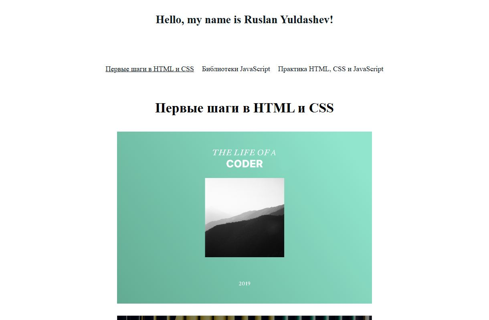

<div align="center">

# 🗂️ Практикум · галерея работ

**Страница-навигация по упражнениям курса веб-разработки.**

 

[Открыть страницу](https://goldlexx.github.io/yandex-practicum-portfolio/)

</div>

Работы собраны в три группы. Первые шаги в HTML и CSS посвящены вёрстке, следующий раздел — библиотекам JavaScript, заключительный — практике с разметкой, стилями и скриптами. Карточки ведут к примерам, а в разделе JavaScript используется фоновое видео без звука.



## Локальный запуск

Раздайте корень репозитория и откройте `http://localhost:8000/`, чтобы пройти по ссылкам к вложенным страницам.

```sh
python -m http.server 8000
```
